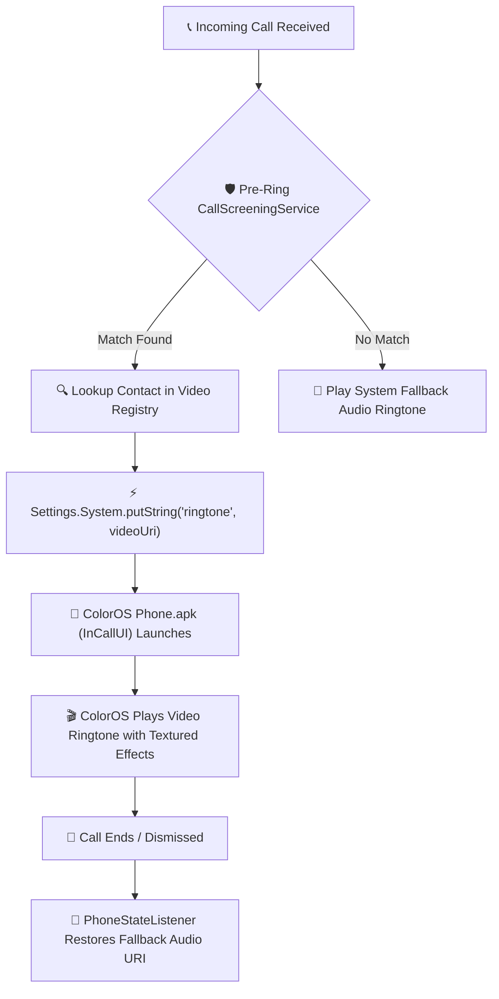
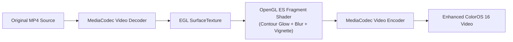

<div align="center">

# ODialer Video Ringtone

### Per-contact video ringtones with ColorOS 16 Textured Visual Effects for non-rooted Oppo & OnePlus devices.

<br/>

[](https://antigravity.google)
[](https://www.oppo.com)
[](#how-it-works)
[](LICENSE)
[](https://openjdk.org/)
[](#textured-visual-effects)

<br/>

[**Features**](#features) · [**How It Works**](#how-it-works) · [**Textured Visual Effects**](#textured-visual-effects) · [**Getting Started**](#getting-started) · [**Architecture**](#technical-architecture) · [**Privacy**](#privacy) · [**License**](#license)

<br/>

</div>

> [!NOTE]
> **A Vibe-Coded Systems Experiment**:
> This project is an Android systems engineering experiment created entirely inside **Google Antigravity**, pairing with Google DeepMind's Gemini models. The companion service, pre-ring CallScreening interceptor, MediaCodec hardware video pipeline, and custom ColorOS 16 OpenGL ES shaders were developed iteratively without rooting or modifying system partition images on a real **Oppo Find X9** (`CPH2797`, ColorOS 16 / Android 16).

---

<div align="center">

<h1><a id="features"></a>Features</h1>

</div>

<table>
  <tr>
    <td width="50%" valign="top">

#### 🎬 Per-Contact Video Ringtones
- Assign unique, full-motion MP4 video ringtones to individual contacts.
- Zero impact on unassigned callers: all other incoming calls cleanly fall back to your normal system audio ringtone.
- Automatic contact auto-matching by placing files named `<Contact Name>.mp4` or `<Phone Number>.mp4` directly into `/sdcard/Ringtones/VideoRingtones/`.

#### 🛡️ Zero Root Required
- Operates entirely in user-space via Android's `CallScreeningService` role and `Settings.System.canWrite`.
- Intercepts incoming calls milliseconds before the ColorOS Phone dialer triggers audio/video ringtones.
- Swaps the system ringtone URI dynamically, hands off execution to the native ColorOS dialer, and restores your fallback audio ringtone immediately upon call termination.

</td>
<td width="50%" valign="top">

#### 🌟 ColorOS 16 Textured Visual Effects
- **Contour Glow**: Real-time edge lighting shader creating luminous rim halos, frosted inner bevels, and specular highlights hugging floating video cards.
- **Dynamic Visual Blur**: Progressive dual-pass Gaussian blur background that samples live video colors in real time.
- **Aspect-Ratio Preserved Ambient Card**: 1:1 geometric scaling ensuring 9:16, 3:4, 1:1, or 16:9 videos float naturally without distortion.
- **Dark Legibility Gradients**: Smooth top and bottom alpha vignetting preserving high contrast for incoming caller text and dialer buttons.

#### ⚡ On-Device Hardware Transcoding
- Fast hardware video processing via Android `MediaCodec`, `MediaExtractor`, `MediaMuxer`, and an EGL `SurfaceTexture` render pipeline.
- Instant per-contact styling controls: toggle between **Ambient Card** and **Full Screen** layouts with a single tap.
- Built-in real call simulator to ring the device live through Android Telecom for testing.

</td>
  </tr>
</table>

---

## <a id="how-it-works"></a>How It Works



1. **Pre-Ring Screening**: Android's `CallScreeningService` receives incoming caller phone numbers before the phone alerts the user or plays ringtones.
2. **Instant Match**: The background service resolves the caller against configured contact mappings or scans `/sdcard/Ringtones/VideoRingtones/`.
3. **Seamless URI Injection**: When an assigned contact is detected, the service swaps `Settings.System.ringtone` to point to the enhanced video file.
4. **Native ColorOS Dialing**: ColorOS's native `com.android.incallui` takes over, rendering the video ringtone directly inside the system call screen.
5. **Safe Restoration**: A registered `PhoneStateListener` intercepts `CALL_STATE_IDLE` when the call ends, instantly reverting the system ringtone URI to your preferred fallback ringtone.

---

## <a id="textured-visual-effects"></a>ColorOS 16 Textured Visual Effects

ColorOS 16 introduced "Textured Visual Effects", emphasizing luminous boundaries, frosted glass translucency, and organic tactile depth. This project brings those exact design principles to video ringtones via hardware OpenGL ES shaders:



- **Contour Glow Shader**: Uses an OpenGL ES 2.0 multi-stop fragment shader (`uEnableContourGlow`) that computes exact signed distance from the card squircle perimeter, projecting an outer luminous glow (`rgba(255, 255, 255, 0.40)`), an intense 1dp specular rim (`rgba(255, 255, 255, 0.85)`), and an inner frosted bevel.
- **Dynamic Progressive Visual Blur**: Downsamples video frames across an 8-tap Gaussian kernel, projecting dynamic ambient lighting across the entire screen behind the floating card.
- **Zero-Squish Aspect Ratio Math**: Dynamically calculates `aspectScale = srcAspect / targetAspect` to guarantee zero vertical compression or horizontal stretch regardless of video dimensions.

---

## <a id="technical-architecture"></a>Technical Architecture

| Component | Class / File | Role |
| :--- | :--- | :--- |
| **Call Interceptor** | [`VideoRingtoneScreeningService.java`](companion-app/src/com/odialer/videoringtone/VideoRingtoneScreeningService.java) | System `CallScreeningService` that receives incoming calls pre-ring. |
| **Ringtone Switcher** | [`ContactVideoResolver.java`](companion-app/src/com/odialer/videoringtone/ContactVideoResolver.java) | Resolves contact numbers, registers local URIs, and switches system settings. |
| **Video Engine** | [`VideoProcessor.java`](companion-app/src/com/odialer/videoringtone/VideoProcessor.java) | EGL/OpenGL ES 2.0 shader pipeline and MediaCodec hardware video transcode. |
| **Call Lifecycle** | [`PhoneCallStateService.java`](companion-app/src/com/odialer/videoringtone/PhoneCallStateService.java) | Monitors phone states and safely restores fallback audio ringtones. |
| **Live Simulator** | [`TestCallConnectionService.java`](companion-app/src/com/odialer/videoringtone/TestCallConnectionService.java) | Android Telecom `ConnectionService` for one-tap real call testing. |
| **Companion App** | [`MainActivity.java`](companion-app/src/com/odialer/videoringtone/MainActivity.java) | Aquamorphic UI with segmented controls, live preview, and battery diagnostics. |

---

## <a id="getting-started"></a>Getting Started

### Prerequisites
- An **Oppo**, **OnePlus**, or **Realme** device running **ColorOS 14, 15, or 16** (Android 14+).
- The native **ODialer** or **ColorOS Phone** app (`com.google.android.dialer` is not supported for video ringtones; use the official ColorOS dialer).
- A computer with `adb` (Android Debug Bridge).

### 1. Download or Build the APK

You can grab the pre-compiled signed APK directly from `dist/`:
```bash
adb install -r dist/ODialerVideoRingtone.apk
```

Or build from source using Java 11 and Android SDK 36:
```powershell
powershell -ExecutionPolicy Bypass -File scripts\build_companion.ps1
```

### 2. Grant Permissions via ADB (One-Time Setup)

To allow the companion app to intercept calls and switch system ringtones without root, run these commands once from your PC:

```bash
# Allow writing system settings (ringtone URI switching)
adb shell appops set com.odialer.videoringtone WRITE_SETTINGS allow

# Set Call Screening role to enable pre-ring interception
adb shell cmd role add-role-holder --user 0 android.app.role.CALL_SCREENING com.odialer.videoringtone

# Grant full media and storage access
adb shell appops set com.odialer.videoringtone MANAGE_EXTERNAL_STORAGE allow
adb shell pm grant com.odialer.videoringtone android.permission.READ_CONTACTS
adb shell pm grant com.odialer.videoringtone android.permission.WRITE_CONTACTS
adb shell pm grant com.odialer.videoringtone android.permission.READ_PHONE_STATE

# Optional: Enable the live call simulation account for 1-tap testing
adb shell telecom set-phone-account-enabled "com.odialer.videoringtone/com.odialer.videoringtone.TestCallConnectionService;odialer_sim_account" 0
```

### 3. Assign Video Ringtones

1. Open **Video Ringtones** on your phone.
2. Tap **+ Assign Video to Contact** and select a contact and any MP4 video.
3. Tap **Preview** to customize effects:
   - Choose **Ambient Card** (floating card with dynamic background blur) or **Full Screen**.
   - Toggle **✨ Contour Glow** edge lighting and **🌓 Call Gradient** legibility darkening.
   - Tap **Apply Style & Enhance** to generate the textured video in seconds.
4. Tap **Ring Live** to simulate an incoming call and verify your video in real time!

---

## <a id="privacy"></a>Privacy & Permissions

- **100% Offline & Private**: Zero internet permissions requested (`android.permission.INTERNET` is not even declared in `AndroidManifest.xml`).
- **No Analytics / Telemetry**: No tracking SDKs, no ad networks, and no cloud dependencies.
- **Your Data Stays on Your Device**: All contact mappings and transcoded videos are stored exclusively on your local device storage.

---

## <a id="license"></a>License

Distributed under the **MIT License**. See [`LICENSE`](LICENSE) for details.

```
Copyright (c) 2026 Aditya (shotbyadii)
```

---

<div align="center">
  <sub>A systems experiment built with Google Antigravity &amp; Gemini.</sub>
</div>
