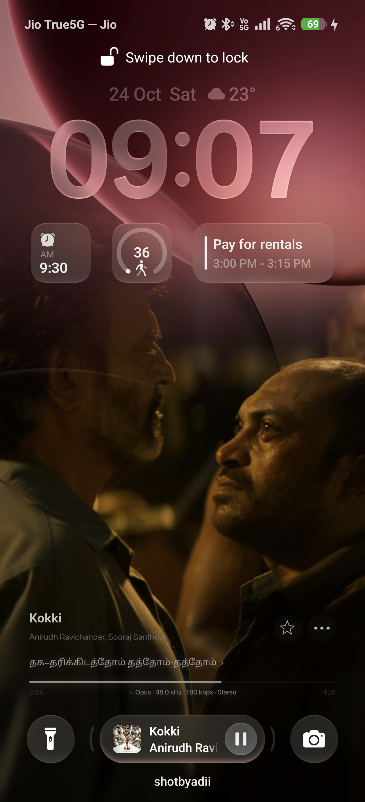
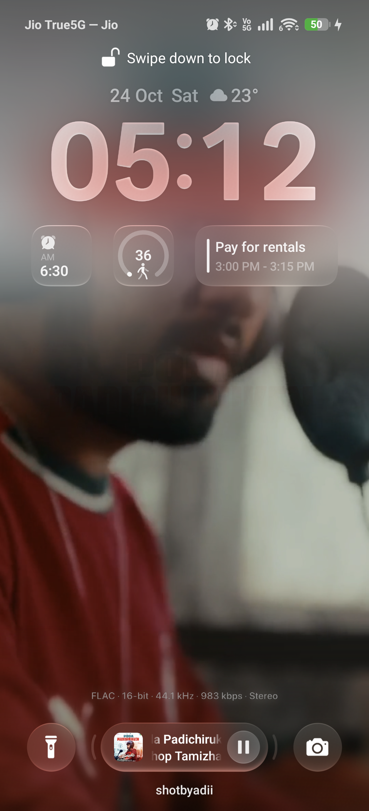
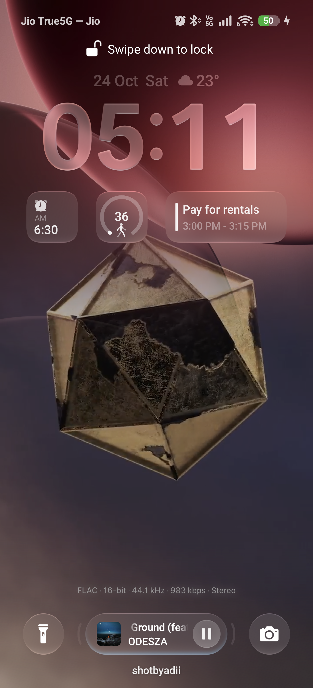
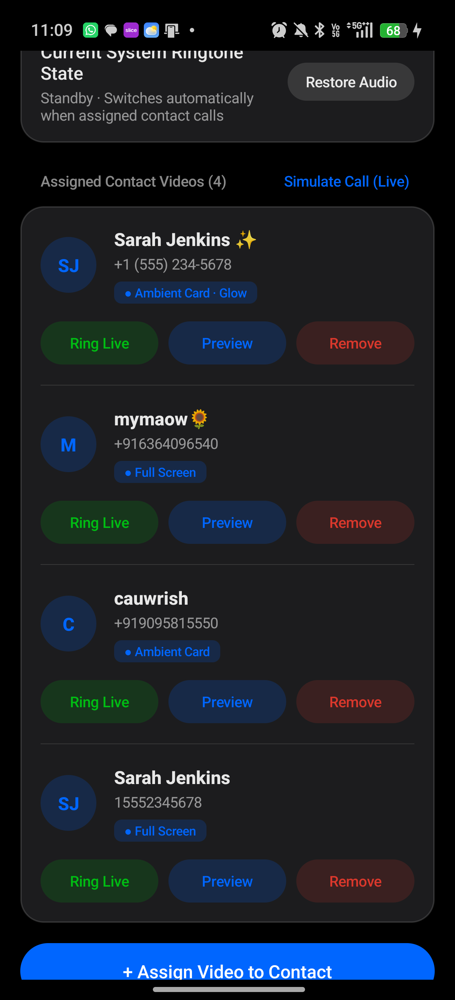
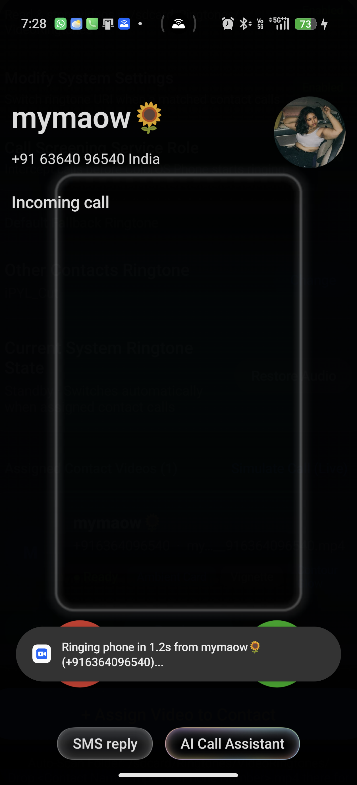

<div align="center">

# ColorOS Mods

### A collection of aesthetic hardware-accelerated mods, visual engines, and companion utilities for Oppo & OnePlus devices running ColorOS 16 & 17.

<br/>

[](https://www.oppo.com)
[](https://www.oppo.com)
[](#modules)
[](#modules)
[](https://antigravity.google)
[](LICENSE)

<br/>

[**Modules Overview**](#modules) · [**Lockscreen Canvas**](#1-lockscreen-canvas-lockscreen-video-cover) · [**ODialer Video Ringtone**](#2-odialer-video-ringtone) · [**Installation**](#quick-installation) · [**Monorepo Structure**](#monorepo-structure) · [**License**](#license)

<br/>

</div>

> [!NOTE]
> **Crafted with Google Antigravity & DeepMind**:
> These mods were developed and refined iteratively on a physical **Oppo Find X9** (`CPH2797`, ColorOS 16 & 17 / Android 16 & 17) using Google Antigravity and Gemini models. All visual enhancements and companion services operate entirely in user-space without unlocking the bootloader, flashing magisk, or altering system partitions.

---

## <a id="modules"></a>Modules Overview

| Module | Directory | Key Highlights |
| :--- | :--- | :--- |
| **Lockscreen Video Cover** | [`lockscreen-canvas/`](lockscreen-canvas/) | 60FPS dynamic canvas live wallpaper, BitChord Now Playing card, live LRCLIB synced lyrics, real-time FLAC/Hi-Res stream upgrade detection, and top wallpaper gradient reveal. |
| **ODialer Video Ringtone** | [`odialer-video-ringtone/`](odialer-video-ringtone/) | Non-root per-contact video ringtones for native ColorOS Phone / ODialer with Contour Glow rim lighting, dynamic visual blur, and pre-ring CallScreening injection. |

---

## 1. Lockscreen Canvas (`lockscreen-canvas`)

<div align="center">
  
  &nbsp;&nbsp;
  
  &nbsp;&nbsp;
  
</div>

### Highlights
- **60FPS Hardware Canvas Engine**: Seamlessly hooks music sessions (**BitChord**, **Spotify**, and **Apple Music**), streaming high-definition vertical canvas loops at 60 FPS using an OpenGL ES 2.0 hardware pipeline.
- **BitChord Now Playing Card & Live Synced Lyrics**:
  - Exact Apple Music / BitChord card layout positioned cleanly directly above the native lockscreen media player pill.
  - Sourced from active media sessions and rendered in authentic Apple SF Pro Display typography.
  - Integrates with the open **LRCLIB** synchronized lyrics API (`lrclib.net`), highlighting active singing lines in real time with trailing `›` chevrons.
  - Interactive scrub bar showing elapsed (`1:03`) and remaining (`-2:06`) timestamps with circular frosted glass action buttons (Favorite Star & 3-Dots menu).
- **Real-Time Lossless FLAC Upgrade Tracking**:
  - Dynamically evaluates active `AudioManager` playback configurations.
  - Detects when BitChord upgrades its stream from initial Opus buffer to CD-quality FLAC (44.1 kHz Red Book) or 24-bit Hi-Res Lossless (96 kHz), updating quality tags on the fly.
  - Clean light microtypography without blur or drop-shadow artifacts.
- **Top Wallpaper Gradient Reveal Feature**:
  - GPU fragment shader feathering curve (`topAlpha = smoothstep(0.77, 0.47, normCoord.y)`).
  - Softly dissolves the top 30% of canvas video, revealing your stock lockscreen wallpaper curves cleanly behind the clock and widgets.
  - User-selectable in app settings: **Top Wallpaper Reveal** vs **Full Screen Canvas**.
- **ColorOS 17 Ambient Artwork Framing**:
  - Automatically downloads 1400×1400 artwork when a song lacks a video canvas.
  - Features aspect-ratio preserved geometric framing with dual-gradient top and bottom ambient blurred extensions.

👉 **[Read Lockscreen Canvas Documentation →](lockscreen-canvas/)**

---

## 2. ODialer Video Ringtone (`odialer-video-ringtone`)

<div align="center">
  
  &nbsp;&nbsp;
  
</div>

### Highlights
- **Per-Contact Video Ringtones Without Root**: Assign unique MP4 videos to individual callers. Unassigned callers seamlessly hear your default system audio ringtone.
- **Pre-Ring CallScreening Interception**: Uses Android's `CallScreeningService` to intercept calls milliseconds before ringing starts, swaps `Settings.System.ringtone`, hands off to native ColorOS `com.android.incallui`, and restores your fallback audio ringtone upon hang-up.
- **ColorOS 16/17 Textured Visual Effects**:
  - **Contour Glow**: Real-time edge lighting shader creating luminous rim halos, frosted inner bevels, and specular highlights hugging floating video cards.
  - **Dynamic Visual Blur**: Progressive dual-pass Gaussian blur background that samples live video colors in real time.
  - **Aspect-Ratio Preserved Ambient Card**: 1:1 geometric scaling ensuring 9:16, 3:4, 1:1, or 16:9 videos float naturally without distortion.
- **Hardware MediaCodec Transcoding**: Fast on-device video transcoding with instant 1-tap real call simulation.

👉 **[Read ODialer Video Ringtone Documentation →](odialer-video-ringtone/)**

---

## <a id="quick-installation"></a>Quick Installation

Pre-compiled, aligned, and signed release APKs are available in the respective `dist/` folders:

### 1. Install Lockscreen Canvas
```powershell
adb install -r -d lockscreen-canvas/dist/LockVideoCover.apk
```
1. Open **Lock Video Cover** → Grant Notification & Storage Access.
2. Tap **Apply Lock Screen Wallpaper** → Select **Lock screen**.
3. Play any track in BitChord, Spotify, or Apple Music!

### 2. Install ODialer Video Ringtone
```powershell
adb install -r -d odialer-video-ringtone/dist/ODialerVideoRingtone.apk
```
Grant required user-space permissions via ADB:
```powershell
adb shell appops set com.odialer.videoringtone WRITE_SETTINGS allow
adb shell cmd role add-role-holder --user 0 android.app.role.CALL_SCREENING com.odialer.videoringtone
adb shell appops set com.odialer.videoringtone MANAGE_EXTERNAL_STORAGE allow
adb shell pm grant com.odialer.videoringtone android.permission.READ_CONTACTS
adb shell pm grant com.odialer.videoringtone android.permission.WRITE_CONTACTS
adb shell pm grant com.odialer.videoringtone android.permission.READ_PHONE_STATE
```

---

## <a id="monorepo-structure"></a>Monorepo Structure

```
coloros-mods/
├── docs/                                  # Showcase screenshots and visual assets
├── lockscreen-canvas/                     # Lock Video Cover module
│   ├── src/com/odialer/lockvideocover/    # OpenGL ES renderer, lyrics engine, audio quality
│   ├── res/                               # ColorOS 17 squircle resources and UI layouts
│   ├── assets/fonts/                      # Apple SF Pro Display typography (Bold, Medium, Regular)
│   ├── build.ps1                          # Standalone aapt2 + javac + d8 + apksigner pipeline
│   └── dist/LockVideoCover.apk            # Pre-compiled signed release APK
├── odialer-video-ringtone/                # ODialer Video Ringtone module
│   ├── companion-app/                     # CallScreeningService, VideoProcessor, InCallUI bridge
│   ├── scripts/build_companion.ps1        # Build automation script
│   └── dist/ODialerVideoRingtone.apk      # Pre-compiled signed release APK
├── .gitignore
├── LICENSE                                # MIT License
└── README.md
```

---

## <a id="license"></a>License

Distributed under the **MIT License**. See [`LICENSE`](LICENSE) for details.

```
Copyright (c) 2026 Aditya (shotbyadii)
```

<div align="center">
  <sub>Engineered with Google Antigravity &amp; Gemini.</sub>
</div>
